 

  
  
  
  

Based in Indonesia | Developer and technology explorer

  

<a href="#about-me">About</a> •
<a href="#featured-projects">Projects</a> •
<a href="#tech-stack">Stack</a> •
<a href="#github-activity">Activity</a> •
<a href="#connect">Connect</a>

---

## About Me

I'm **Muhammad Zaidan Faiz** | also known as **ZFDEV_ID** and **ZDNCH**.

I enjoy turning unusual ideas into experiments, whether that means building web apps, customizing Android interfaces, or digging into emulators and low-level systems. I care about **working prototypes, practical learning, and documenting what actually happens**, including the bugs.

  

<table>
  <tr>
    <td valign="top" width="50%">
      <b>Exploring</b> 
      Android internals, QEMU virtualization, web platforms, and open-source tooling
    </td>
    <td valign="top" width="50%">
      <b>How I work</b> 
      Prototype → test → debug → improve → share
    </td>
  </tr>
  <tr>
    <td valign="top">
      <b>Interests</b> 
      UI engineering, operating systems, automation, and software research
    </td>
    <td valign="top">
      <b>Philosophy</b> 
      Curiosity is useful when it becomes something you can build and test
    </td>
  </tr>
</table>

  

## Featured Projects

These are real projects and experiments from my repositories | some are actively evolving, and some are research prototypes.

<table>
<tr>
<td width="50%" valign="top">

<h3><a href="https://github.com/zaidanfaiz/Instagram-LiquidGlass-LSPosed">Instagram Liquid Glass</a></h3>

An experimental <strong>LSPosed module</strong> exploring a glass-like interface and navigation changes inside Instagram for Android.

<code>Android</code> <code>LSPosed</code> <code>UI Modding</code>

</td>
<td width="50%" valign="top">

<h3><a href="https://github.com/zaidanfaiz/Qemu-aplication">QEMU Application</a></h3>

An experimental <strong>native Android frontend for QEMU</strong>, focused on managing virtual machine experiments from an app.

<code>Android</code> <code>QEMU</code> <code>Virtualization</code>

</td>
</tr>
<tr>
<td width="50%" valign="top">

<h3><a href="https://github.com/zaidanfaiz/ios-emulator">iOS Emulator Research</a></h3>

Exploring <strong>iOS userspace boot paths under QEMU/ARM64</strong>. A research project | not a finished graphical iOS emulator.

<code>ARM64</code> <code>QEMU</code> <code>Systems Research</code>

</td>
<td width="50%" valign="top">

<h3><a href="https://github.com/zaidanfaiz/cbt-project">ZDNCH Belajar CBT</a></h3>

A web-based <strong>computer-based test and learning platform</strong>, with practice features, explanations, and question management.

<code>Node.js</code> <code>Express</code> <code>PostgreSQL</code>

</td>
</tr>
<tr>
<td colspan="2" valign="top">

<h3><a href="https://github.com/zaidanfaiz/artikel">Zaidan Journal</a></h3>

A Markdown-powered tech journal for tutorials, engineering notes, and experiments published using GitHub Pages.

<code>Markdown</code> <code>JavaScript</code> <code>GitHub Pages</code>

</td>
</tr>
</table>

  

## Tech Stack

**Languages & frameworks**

**Platforms & tools**

 

## Engineering Process

  

My work spans UI engineering, Android tooling, and virtualization. I focus on reproducible experiments and documenting actual results instead of showcasing unverified metrics.

**[Explore my public repositories](https://github.com/zaidanfaiz?tab=repositories)**

## Contribution History

  <picture>
    <source media="(prefers-color-scheme: dark)" srcset="https://raw.githubusercontent.com/zaidanfaiz/zaidanfaiz/output/github-contribution-grid-snake-dark.svg"/>
    <source media="(prefers-color-scheme: light)" srcset="https://raw.githubusercontent.com/zaidanfaiz/zaidanfaiz/output/github-contribution-grid-snake.svg"/>
    
  </picture>
  Contribution animation generated from GitHub activity by the repository workflow.

## Connect

Interested in code, mobile experimentation, emulation, or collaborating on something new?

  

**Code. Game. Create.**

Build things. Learn deeply. Keep experimenting.

